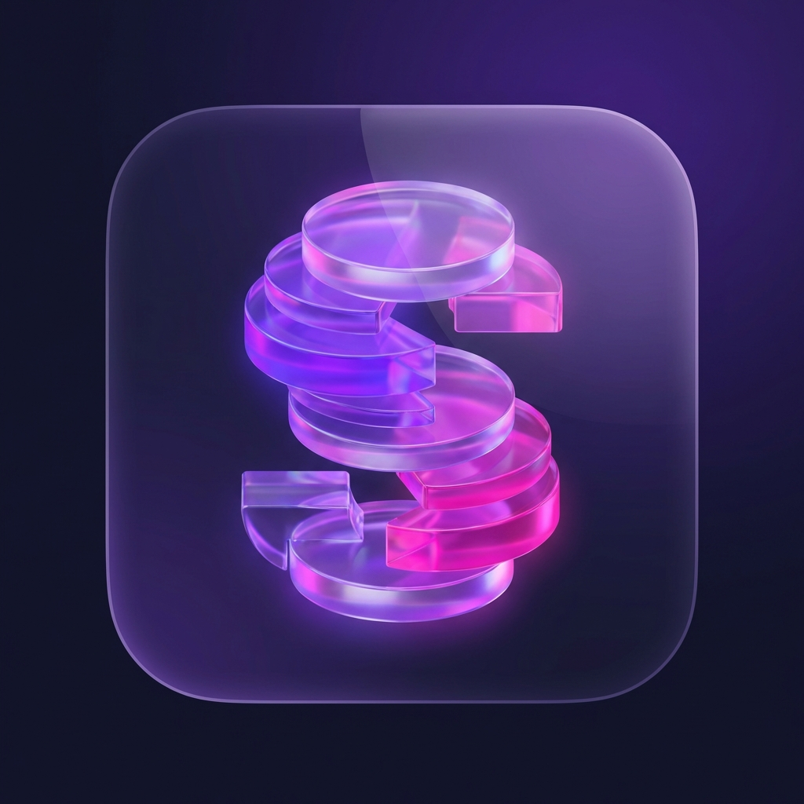

<div align="center">



# SubSaver

**The #1 Finance App for Students**

Track subscriptions, unlock student discounts, and stop wasting money.

[](https://subsaver-mu.vercel.app)
[](https://subsaver-production.up.railway.app/docs)
[](https://nextjs.org)
[](https://fastapi.tiangolo.com)

</div>

---

## ✨ What is SubSaver?

SubSaver is a smart subscription management platform built specifically for students. It helps you track every subscription you pay for, automatically find student discounts, and get notified before you're charged — all in one beautiful dark interface.

> 🎓 Students lose an average of **$847/year** by missing student discounts. SubSaver fixes that.

---

## 🖼️ Screenshots

| Landing Page | Dashboard | Customize |
|:---:|:---:|:---:|
| Hero with floating subscription cards, animated stats, and feature showcase | Full analytics suite: spending trends, billing calendar, insights | Drag-and-drop widget editor with live dashboard preview |

---

## 🚀 Key Features

### 💳 Subscription Management
- Add, edit, delete, and **duplicate** subscriptions
- Monthly & yearly billing cycles
- **Cost splitting** — split Netflix with roommates and track your exact share
- Status tracking: Active, Cancelled, Trial, Paused
- **Search, filter & sort** by name, price, date, status, category
- **Export to CSV** — download your full subscription list

### 🎓 Student Discounts
- Database of **200+ services** with verified student pricing (Spotify, Adobe CC, Microsoft 365, Xbox Game Pass, and more)
- Verify your `.edu` email to unlock exclusive pricing
- Automatic discount detection across all your active subscriptions
- **Real savings tracking** — see exactly how much you've saved

### 📊 Advanced Analytics
- **Spending Trends** — 6-month area chart of your total expenses (respects cancellations & cost splits)
- **Category Breakdown** — pie chart showing where your money goes
- **Insights Panel** — smart tips: upcoming renewals, category dominance alerts, annual plan savings opportunities
- **Billing Calendar** — full monthly calendar view of every payment date
- **Stats Grid** — 8 configurable metric cards (monthly spend, yearly projection, avg per sub, and more)

### 🔔 Email Reminders
- Automated renewal reminders sent N days before each charge
- Styled HTML email templates for: email confirmation, student verification, password reset, and renewal alerts
- Powered by **APScheduler** — runs silently in the background

### 🎨 Dashboard Customization
- **Drag-and-drop** widget reordering powered by `@dnd-kit`
- Toggle any widget on/off
- Resize widgets: 1/4, 2/4, 3/4, or full width
- **3 Layout Presets**: Student Focus · Budget Mode · Overview
- **3 Density modes**: Comfortable · Standard · Compact
- **Multi-currency**: USD · EUR · GBP with live exchange rates
- Undo/Redo history (up to 20 states)
- Live dashboard preview while you configure

### 🔐 Security
- JWT authentication (HS256, 24h expiry)
- bcrypt password hashing with transparent upgrade
- **Rate limiting** on all auth endpoints (slowapi)
- Constant-time code comparison (timing-attack safe)
- Email confirmation required at registration
- Password confirmation required to delete account

---

## 🛠️ Tech Stack

### Frontend
| | Technology | Version |
|---|---|---|
| ⚡ | **Next.js** | 16.1.3 |
| ⚛️ | **React** | 19.2.3 |
| 🔷 | **TypeScript** | ^5 |
| 🎨 | **TailwindCSS** | ^4 |
| 📊 | **Recharts** | ^3.6.0 |
| 🖱️ | **@dnd-kit** | ^6.3 / ^10 |
| 🎬 | **Framer Motion** | ^12.27 |
| 🔣 | **Lucide React** | ^0.562 |
| 📅 | **date-fns** | ^4.1.0 |

### Backend
| | Technology | Version |
|---|---|---|
| ⚡ | **FastAPI** | 0.104.1 |
| 🐍 | **Python** | 3.11+ |
| 🗄️ | **SQLAlchemy** | 2.0.23 |
| 🔄 | **Alembic** | 1.13.1 |
| ✅ | **Pydantic** | 2.5.0 |
| 🔑 | **python-jose** | 3.3.0 (JWT) |
| 🔒 | **bcrypt** | 4.1.2 |
| 🕐 | **APScheduler** | 3.10.4 |
| 🐌 | **slowapi** | 0.1.9 |
| 📧 | **Jinja2** | 3.1.2 |
| 🐘 | **psycopg2** | 2.9.9 |

### Infrastructure
| Service | Role |
|---|---|
| **Vercel** | Frontend hosting (Next.js) |
| **Railway** | Backend hosting (FastAPI + Docker) |
| **Neon** | Serverless PostgreSQL |
| **Mailtrap** | SMTP email (dev sandbox + production) |

---

## 🏗️ Architecture

```
┌──────────────────────────────────────────────────┐
│               CLIENT (Vercel)                    │
│   Next.js 16 App Router  ·  React 19  ·  TS     │
│                                                  │
│  /           /dashboard   /customize  /settings  │
│  /login      /register    /verify-email          │
└─────────────────────┬────────────────────────────┘
                      │  HTTPS · JWT Bearer
┌─────────────────────▼────────────────────────────┐
│               BACKEND (Railway)                  │
│              FastAPI 0.104 · Python 3.11         │
│                                                  │
│  /auth/*    /subscriptions/*   /api/analytics/*  │
│  /api/student-discounts/*      /api/reminders/*  │
│  /users/me  /categories/*      /health           │
│                                                  │
│   ┌──────────┐  ┌────────────┐  ┌────────────┐  │
│   │  JWT     │  │ Scheduler  │  │   Email    │  │
│   │  Auth    │  │(APScheduler│  │  Service   │  │
│   └──────────┘  └────────────┘  └────────────┘  │
└─────────────────────┬────────────────────────────┘
                      │  SQLAlchemy ORM
┌─────────────────────▼────────────────────────────┐
│              DATABASE (Neon)                     │
│           Serverless PostgreSQL                  │
│                                                  │
│   users ◄──────────── subscriptions             │
│                                                  │
│           student_discounts                      │
└──────────────────────────────────────────────────┘
```

---

## 📁 Project Structure

```
subsaver/
├── backend/
│   ├── core/               # Security utils (JWT, bcrypt)
│   ├── migrations/         # Alembic migrations
│   ├── models/             # SQLAlchemy ORM models
│   │   ├── db.py           # User + Subscription models
│   │   └── student_discount.py
│   ├── routers/            # FastAPI route handlers
│   │   ├── auth.py         # Auth + email verification
│   │   ├── subscriptions.py
│   │   ├── analytics.py    # Trends + insights
│   │   ├── student_discounts.py
│   │   ├── reminders.py
│   │   └── categories.py
│   ├── schemas/            # Pydantic request/response schemas
│   ├── services/
│   │   ├── email_service.py   # SMTP email sender
│   │   ├── reminder_service.py
│   │   └── scheduler.py       # APScheduler setup
│   ├── scripts/
│   │   └── seed_discounts.py  # Seed 200+ student discounts
│   ├── templates/          # Jinja2 HTML email templates
│   ├── config.py           # Pydantic settings
│   ├── database.py         # SQLAlchemy engine/session
│   ├── dependencies.py     # FastAPI dependencies
│   ├── main.py             # App entrypoint
│   ├── Dockerfile
│   ├── Procfile
│   └── requirements.txt
│
└── frontend/
    └── app/
        ├── components/         # Reusable UI components
        │   ├── AdvancedAnalytics.tsx
        │   ├── BillingCalendar.tsx
        │   ├── CategoryBreakdown.tsx
        │   ├── SpendingTrendsChart.tsx
        │   ├── InsightsPanel.tsx
        │   ├── UpcomingRenewals.tsx
        │   ├── StudentSavingsCard.tsx
        │   ├── ServicePickerModal.tsx
        │   ├── EditSubscriptionModal.tsx
        │   ├── OnboardingModal.tsx
        │   ├── VerificationModal.tsx
        │   ├── ToastProvider.tsx
        │   └── SkeletonLoader.tsx
        ├── dashboard/          # Main dashboard page
        ├── customize/          # Dashboard customization
        ├── settings/           # Account settings
        ├── login/              # Auth pages
        ├── register/
        ├── verify-email/
        ├── lib/                # Utilities (api, currency, categories)
        ├── types/              # TypeScript interfaces
        ├── globals.css         # Design system + animations
        └── page.tsx            # Landing page
```

---

## ⚙️ Local Development

### Prerequisites
- **Python** 3.11+
- **Node.js** 20+
- **PostgreSQL** (or a free [Neon](https://neon.tech) account)

---

### 1. Backend Setup

```bash
cd backend

# Create and activate virtual environment
python -m venv .venv
.venv\Scripts\activate        # Windows
# source .venv/bin/activate   # macOS/Linux

# Install dependencies
pip install -r requirements.txt

# Configure environment
cp .env.example .env
# Edit .env and fill in your values (see Environment Variables section)

# Apply database migrations
alembic upgrade head

# Seed student discount database (200+ services)
python scripts/seed_discounts.py

# Start the development server
uvicorn main:app --reload --port 8000
```

- **API:** http://localhost:8000
- **Swagger Docs:** http://localhost:8000/docs
- **ReDoc:** http://localhost:8000/redoc

---

### 2. Frontend Setup

```bash
cd frontend

# Install dependencies
npm install

# Configure environment
echo "BACKEND_URL=http://localhost:8000" > .env.local

# Start the development server
npm run dev
```

- **App:** http://localhost:3000

---

## 🔑 Environment Variables

### Backend — `backend/.env`

| Variable | Required | Default | Description |
|---|---|---|---|
| `JWT_SECRET` | ✅ | — | Long random secret (64+ chars recommended) |
| `DATABASE_URL` | ✅ | `sqlite:///./subsaver.db` | PostgreSQL or SQLite connection string |
| `ALLOWED_ORIGINS` | ✅ | `http://localhost:3000` | Comma-separated CORS origins |
| `FRONTEND_URL` | ✅ | `https://subsaver.example` | Used in email links |
| `ENVIRONMENT` | — | `production` | `development` enables dev debug codes |
| `SMTP_HOST` | — | — | SMTP host (e.g. `sandbox.smtp.mailtrap.io`) |
| `SMTP_PORT` | — | `2525` | SMTP port |
| `SMTP_USER` | — | — | SMTP username |
| `SMTP_PASSWORD` | — | — | SMTP password |
| `SMTP_FROM_EMAIL` | — | `noreply@subsaver.example` | Sender address |

> **Note:** The server starts even without SMTP configured — emails are simply skipped with a warning log.

### Frontend — `frontend/.env.local`

| Variable | Required | Description |
|---|---|---|
| `BACKEND_URL` | ✅ | Backend API URL (used by Next.js server-side proxy) |

---

## 🚀 Deployment

### Railway (Backend)

1. Create a new Railway project and connect your GitHub repo
2. Set **Root Directory** → `backend`
3. Railway will auto-detect the `Dockerfile` — no extra config needed
4. Add all backend environment variables in **Railway → Variables**
5. The `Procfile` handles migrations + server start:
   ```
   web: alembic upgrade head && python scripts/seed_discounts.py && uvicorn main:app --host 0.0.0.0 --port $PORT
   ```

### Vercel (Frontend)

1. Import your GitHub repo in Vercel
2. Set **Root Directory** → `frontend`
3. Add environment variable: `BACKEND_URL=https://your-railway-app.up.railway.app`
4. Deploy — Vercel handles everything else automatically

---

## 📡 API Reference

Full interactive docs available at `/docs` on any running backend instance.

### Auth Endpoints
| Method | Endpoint | Description |
|---|---|---|
| `POST` | `/auth/register` | Register (sends 6-digit email code) |
| `POST` | `/auth/confirm-email` | Confirm email with code |
| `POST` | `/auth/login` | Login → JWT token |
| `POST` | `/auth/forgot-password` | Request password reset code |
| `POST` | `/auth/reset-password` | Reset password with code |
| `POST` | `/auth/verify-edu` | Request `.edu` student verification |
| `POST` | `/auth/verify-edu/confirm` | Confirm student status |
| `GET` | `/users/me` | Get current user profile |
| `DELETE` | `/users/me` | Delete account (requires password) |

### Subscription Endpoints
| Method | Endpoint | Description |
|---|---|---|
| `GET` | `/subscriptions` | List all subscriptions |
| `POST` | `/subscriptions` | Create subscription |
| `PATCH` | `/subscriptions/{id}` | Update subscription |
| `DELETE` | `/subscriptions/{id}` | Delete subscription |

### Analytics Endpoints
| Method | Endpoint | Description |
|---|---|---|
| `GET` | `/api/analytics/trends` | 6-month spending trends + category breakdown |
| `GET` | `/api/analytics/insights` | Smart recommendations |

### Student Discounts Endpoints
| Method | Endpoint | Description |
|---|---|---|
| `GET` | `/api/student-discounts` | All available discounts (public) |
| `POST` | `/api/student-discounts/batch-check` | Check discounts for multiple subs at once |
| `POST` | `/api/student-discounts/apply/{id}` | Apply student discount to subscription |
| `GET` | `/api/student-discounts/savings` | Savings summary (applied + potential) |

### System
| Method | Endpoint | Description |
|---|---|---|
| `GET` | `/health` | Health check (`{"status": "ok"}`) |

---

## 🗺️ Project Timeline

| Period | Milestone |
|---|---|
| **Nov 2025** | Project concept & technical specification document written |
| **Jan 2026** | Development started — Next.js + FastAPI scaffolding, first pages |
| **Late Jan 2026** | First working concept with web pages demonstrating the core idea |
| **Feb 2026** | Email system integrated (Mailtrap/SMTP), full UI redesign (dark glassmorphism) |
| **Mar 2026** | Dashboard customization, drag-and-drop widgets, PostgreSQL via Neon connected |
| **Apr 2026** | Deployed to Vercel + Railway, mobile responsive polish, onboarding modal, production hardening |

---

## 🤝 Contributing

Contributions are welcome! Feel free to open an issue or submit a pull request.

1. Fork the repository
2. Create your feature branch: `git checkout -b feature/amazing-feature`
3. Commit your changes: `git commit -m 'Add amazing feature'`
4. Push to the branch: `git push origin feature/amazing-feature`
5. Open a Pull Request

---

## 📄 License

This project is licensed under the MIT License.

---

<div align="center">

Built with ❤️ for students everywhere

**[Live Demo](https://subsaver-mu.vercel.app)** · **[API Docs](https://subsaver-production.up.railway.app/docs)** · **[Report Bug](https://github.com/Helios84/subsaver/issues)**

</div>
